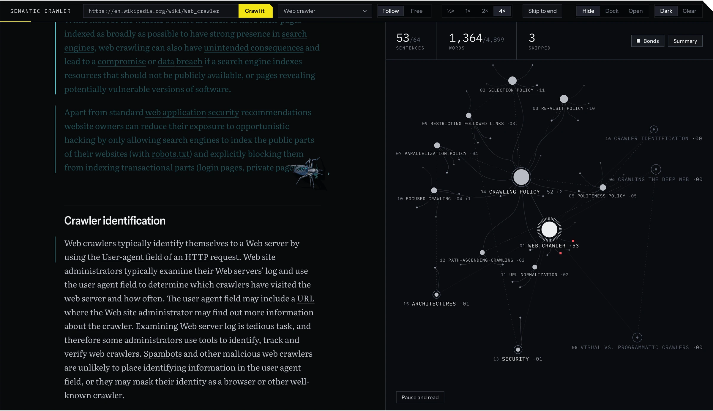
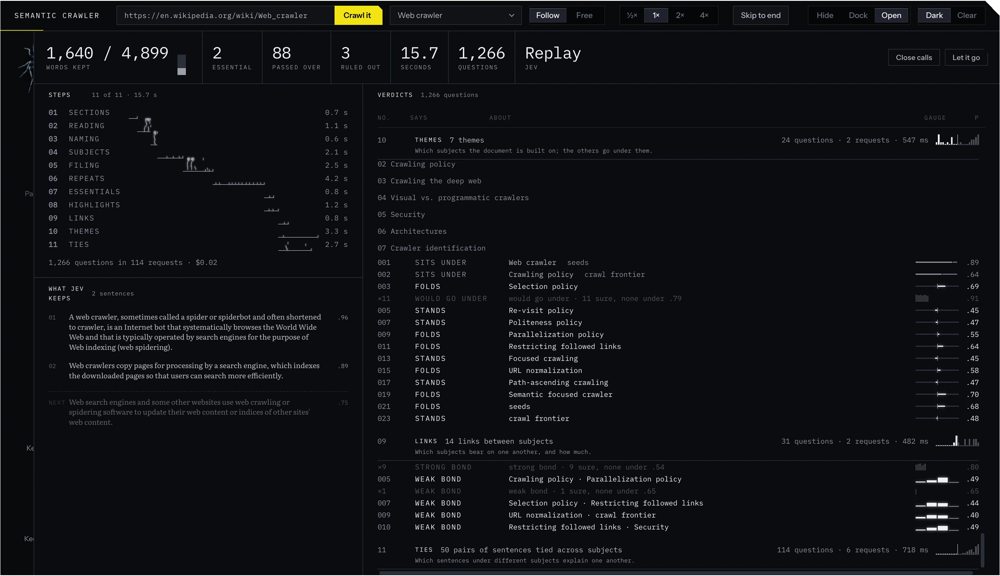
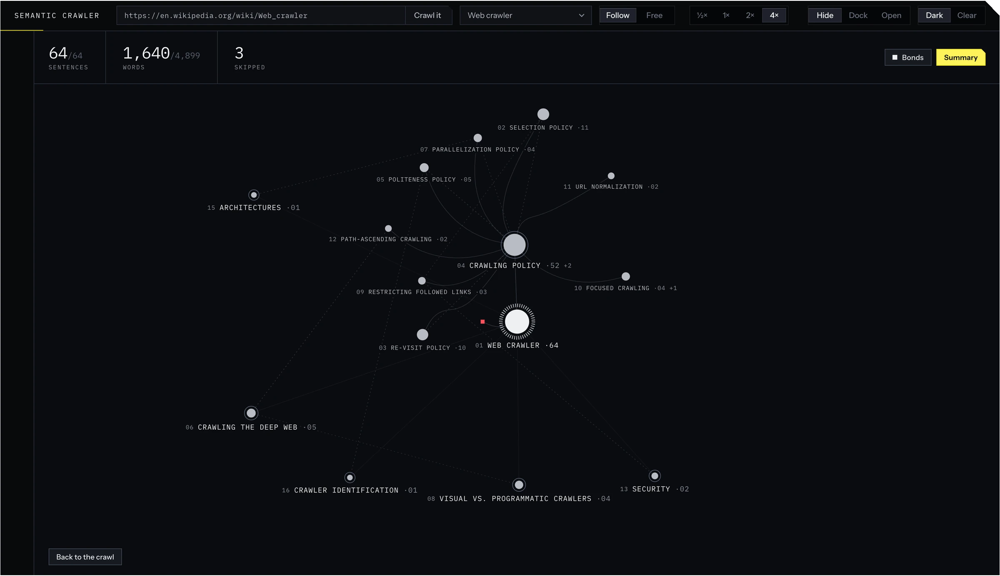

<h1 align="center">Spidi</h1>

<p align="center">A web crawler you can watch</p>

<p align="center"></p>

Spidi reads a web page the way a careful editor would and lets you watch it happen. A spider crawls down the text, eats the sentences worth keeping letter by letter, and files each one on a graph under the subject it belongs to. Everything it eats and every place it files it was decided beforehand by Jev, a small typed decision model from [TypeSafe](https://docs.typesafe.ai), so no language model writes or rewrites a single word: the web is made of the page's own sentences. Reading the Wikipedia article above took Jev 1,266 questions, about fifteen seconds and two cents.

## Try it

```sh
git clone https://github.com/Caliko06/spidi-crawler
cd spidi-crawler
npm install
npm start
```

Open http://127.0.0.1:4317, pick a page from the list and press Crawl it. The pages in the list replay from answers Jev already gave, which are kept in `corpus/`, so they need neither a key nor a network connection. To crawl an address of your own, copy `.env.example` to `.env.local` and add an AI Gateway key, since Jev is reached through Vercel's AI Gateway; the server stops at fifty cents of questions per session.

## How it works

<p align="center"></p>

Jev answers typed questions about the page (yes or no, a choice, a rating) with a probability instead of text. A page takes anywhere from a couple of hundred to several thousand of them, asked in ten steps that decide which sections are apparatus, which sentences are worth keeping, which one carries the whole document and what each sentence is about. Only when that plan is complete does the spider start to move, and every answer is stored on disk, so asking the same thing again costs nothing. The ten steps are written out in [docs/architecture.md](docs/architecture.md).

## What you see

The console on the right shows Jev working while the plan is made: eleven steps along a timeline, and every question it was asked with a gauge for how sure it was, the close calls marked as such.

<p align="center"></p>

When the spider has laid everything, the web is a graph in the way Obsidian draws one. Themes sit on rings by weight, subjects hang from them, and the dashed lines are the bonds Jev found between subjects. You can drag one subject toward another to merge them, and it only falls in when Jev says the two share enough, so the grouping follows the page's meaning and not just which nodes happen to sit close.

<p align="center"></p>

The spider is a character more than an animation. It notices your pointer, turns to it and flinches if you come at it fast; it stands off a subject you are holding and bites through a merge; it spits a fusion back out when you press Cmd+Z. The window is dark by default and has a light Clear ground on a switch in the bar, and the design rules behind it are in [docs/design.md](docs/design.md).

## How well Jev decides

Across thirty-six pages Jev was asked 38,741 questions, which came to $0.71, and it answered each request in about 350 milliseconds. To judge the quality of its decisions, a language model that had read each whole page was asked the same things, and the chart shows how close Jev comes to that model as a share of how close the model comes to itself on a second pass.

<p align="center"></p>

Jev is closest on the structural choices and furthest from the teacher on which sentences are essential, at 41%, which is the weakest of its decisions. The comparison says nothing about what a language model would cost or how fast it would be on the same questions, because that was not measured. The method, every page and the commands to reproduce all of it without spending anything are in [docs/bench.md](docs/bench.md).

## Repo map

| Path | What is in it |
| --- | --- |
| `src/` | The reader, in the browser. `main.js` wires it; `page.js` the text; `console.js`, `watch.js` the dock; `web.js` the graph; `crawler*.js`, `heed.js`, `agency.js` the spider |
| `lib/` | The plan, on the server. `crawl.js` fetches, `triage.js` decides what is kept, `subjects.js` what it is filed under, `jev.js` asks Jev, `lines.js` holds every threshold |
| `server.mjs` | Serves the reader and streams the plan |
| `corpus/` | The pages, Jev's kept answers and the plans made of them; `bench/` measures Jev; `gold/` holds the references |
| `art/`, `assets/` | The spider, modelled in Blender and exported to `assets/spidi.glb` |
| `docs/` | [Architecture](docs/architecture.md), [bench](docs/bench.md), [design](docs/design.md) |

There is also a `/notebook` mode: it relates two or more sources (pages, PDFs, addresses) to one another as a web, and it is the one place where a language model, through the Codex CLI, makes the decisions.

## Credits and licence

Code: [MIT](LICENSE). Fonts: SIL Open Font License ([fonts/](fonts/README.md)). Each page in `corpus/` keeps its author's credit in the `index.json` of its set (Wikipedia, CC BY-SA, among others).
