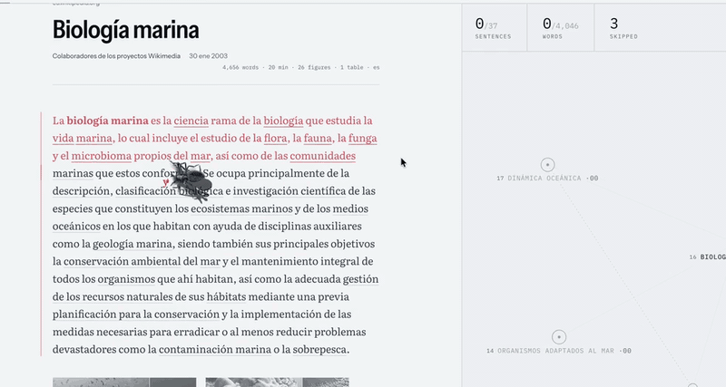
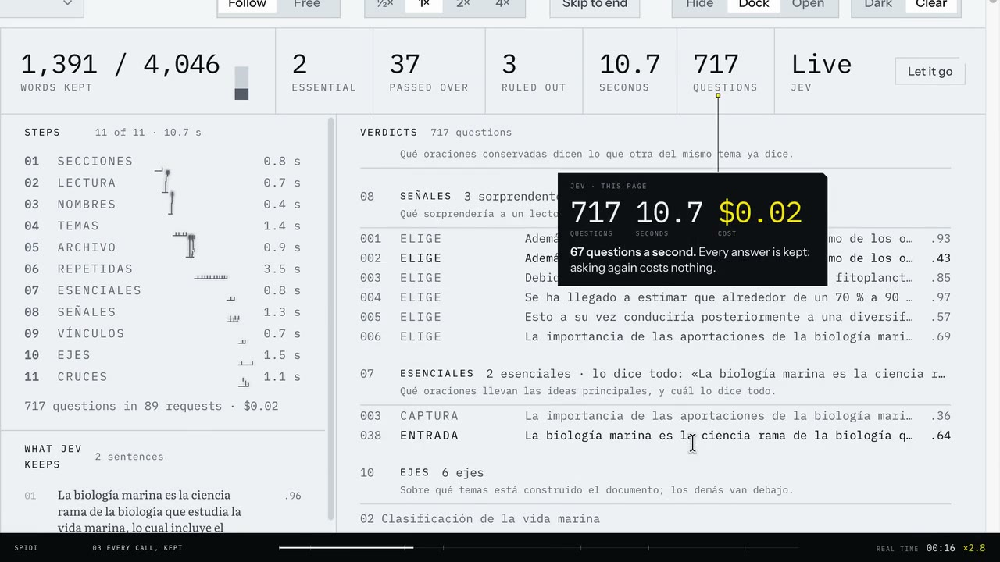
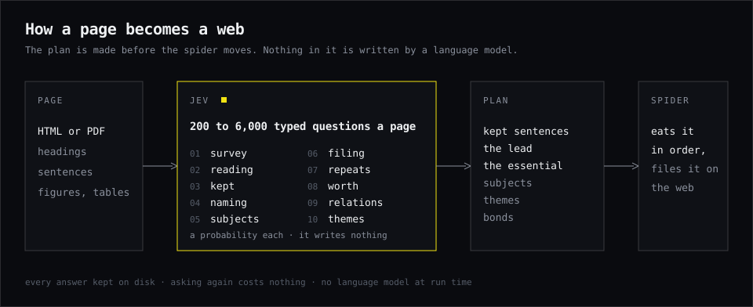
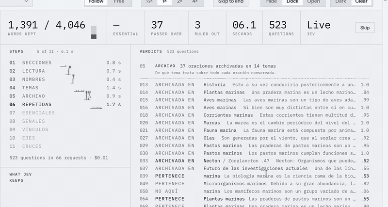
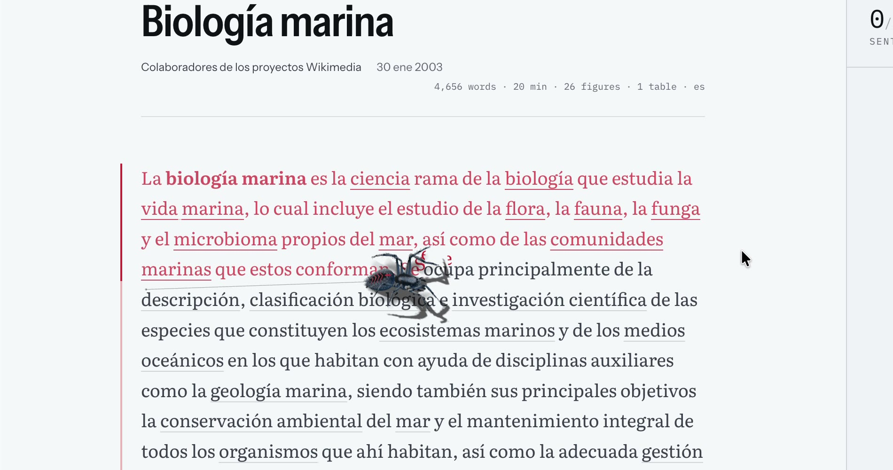
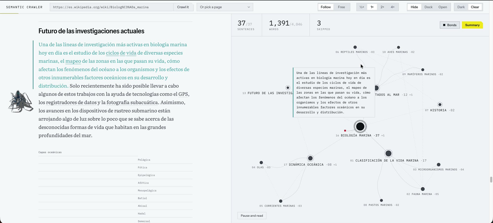
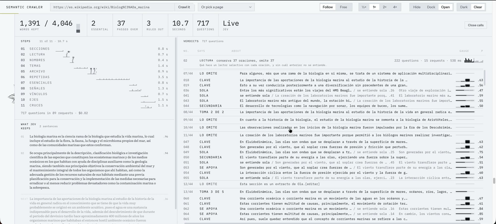
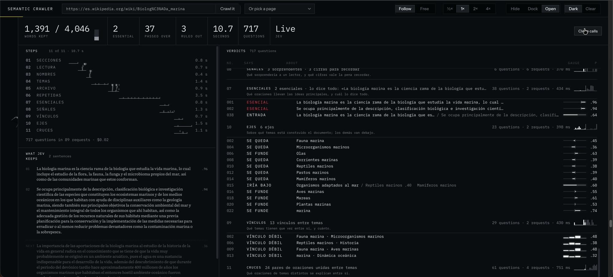
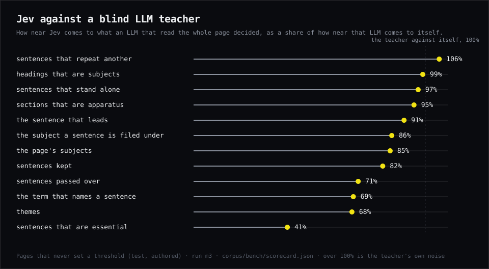
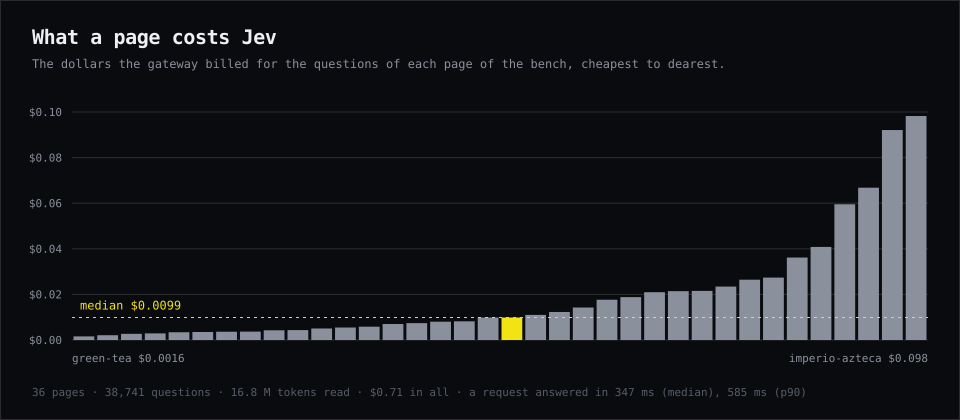

# Spidi

**A web crawler you can watch.** A spider eats the sentences worth keeping, letter by letter, and files each one on a web under the subject it is about. What it eats and where it files it was decided before it moved, by **Jev**, and by no language model.

<p align="center"></p>

<p align="center"><a href="docs/media/spidi.mp4"></a><br><sub>Demo · 59 s · no sound</sub></p>

**Jev reads a page for about a cent** (median $0.0099, 36 pages) and comes within [82% of what a blind LLM teacher agrees with itself on](docs/bench.md), on which sentences to keep.

[Try it](#try-it) · [How it works](#how-it-works) · [What you see](#what-you-see) · [Bench](#bench) · [Repo map](#repo-map)

## Try it

```sh
git clone https://github.com/Caliko06/spidi-crawler
cd spidi-crawler
npm install
npm start          # http://127.0.0.1:4317/
```

Pick a page from the list and press **Crawl it**. The pages in the picker replay from the answers kept in `corpus/`, so they need no key and cost nothing.

For an address of your own, Jev has to be asked: `cp .env.example .env.local` and put an AI Gateway key in it (Jev is [TypeSafe](https://docs.typesafe.ai)'s model, reached through Vercel's AI Gateway). The server stops at $0.50 of questions until it is restarted. Layout holds from 1280 px wide.

## How it works

<p align="center"></p>

Jev answers **typed questions** (yes or no, a choice, a rating, a quoted run) with a probability, and writes nothing: every word on the web is a word of the page. The plan is made in ten steps before the spider moves, and every answer is kept on disk, so asking the same thing again costs nothing.

One Spanish Wikipedia article, asked live:

<p align="center"></p>

| | |
| --- | --- |
| Questions | 717, in 89 requests and 11 steps |
| Time | 10.7 s |
| Cost | $0.02 |
| Kept | 1,391 of 4,046 words; 2 sentences essential, 37 passed over, 3 ruled out |

The ten steps are in [docs/architecture.md](docs/architecture.md).

## What you see

The window is two halves: the text, and the web.

**The spider.** It weaves down the text, eats the kept sentences in order, and with sixty words in it walks out to the web to file them. It notices your pointer (turns to it, flinches, threatens, swats) and acts on your work on the web: it stands off a subject you hold, bites a merge, spits a fusion back on Cmd+Z, and goes down the summary touching each essential sentence.

<p align="center"></p>

**The web.** A graph laid out by d3-force, as Obsidian draws one. Themes sit on rings by weight and subjects hang from them. Each sentence the spider lays is a small node on its subject; once it has eaten everything, only the essential ones stay as beads. Drag a subject toward another and Jev's bond between them shows; it falls in only on a close one. **Summary** opens everything laid so far, and **Copy as Markdown** exports it.

<p align="center"></p>

**The dock.** Open it and every question Jev was asked is there, by step, each with its gauge, and the close calls shown as such.

<p align="center"></p>

Dark by default, a Clear ground on a switch in the bar.

<p align="center"></p>

The design rules are in [docs/design.md](docs/design.md).

## Bench

36 pages, 38,741 questions, 16.8 million tokens read, **$0.71 in all**. A request is answered in 347 ms at the median.

<p align="center"></p>

Jev is near the teacher on the structural decisions and furthest from it on **what is essential (41%)**; that is the weakest decision and it is in the chart. What is not measured here is an LLM's cost or speed on the same questions, so nothing is claimed about it.

<p align="center"></p>

Method, every page, and how to reproduce it (free, from the kept answers): [docs/bench.md](docs/bench.md).

## Repo map

| Path | What is in it |
| --- | --- |
| `src/` | The reader, in the browser. `main.js` wires it; `page.js` the text; `console.js`, `watch.js` the dock; `web.js` the graph; `crawler*.js`, `heed.js`, `agency.js` the spider |
| `lib/` | The plan, on the server. `crawl.js` fetches, `triage.js` decides what is kept, `subjects.js` what it is filed under, `jev.js` asks Jev, `lines.js` holds every threshold |
| `server.mjs` | Serves the reader and streams the plan |
| `corpus/` | The pages, Jev's kept answers and the plans made of them; `bench/` measures Jev; `gold/` holds the references |
| `art/`, `assets/` | The spider, modelled in Blender and exported to `assets/spidi.glb` |
| `docs/` | [Architecture](docs/architecture.md), [bench](docs/bench.md), [design](docs/design.md) |

Also: `/notebook` relates two or more sources (pages, PDFs, addresses) to each other as a web. It is the one exception to "no language model": there an LLM, through the Codex CLI, decides everything.

## Credits and licence

Code: [MIT](LICENSE). Fonts: SIL Open Font License ([fonts/](fonts/README.md)). Each page in `corpus/` keeps its author's credit in the `index.json` of its set (Wikipedia, CC BY-SA, among others).
