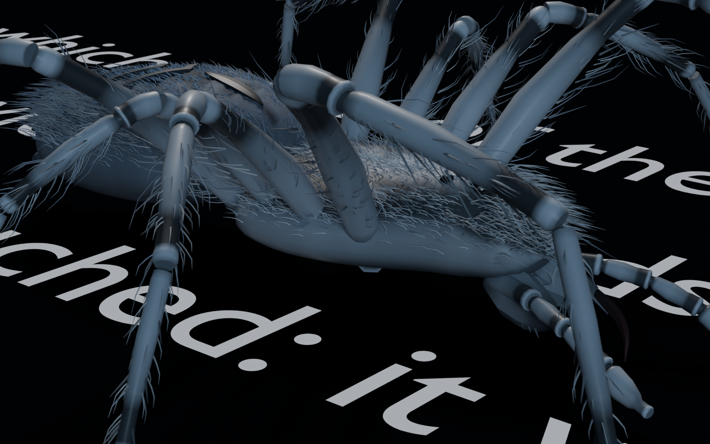

# Design

Spidi is an instrument, not a dashboard. It decides few things and holds to them.

## The ground

- **Dark by default**, near-black (`#08090c`), with a **Clear** ground on a switch in the bar.
- **Three faces, one role each.** Plex Mono for the web and its readouts, Instrument Sans for the interface, Literata for the text being read.
- **Hierarchy comes from light**: two or three steps of grey on one ground. Size and weight are the last resort.
- **Hairlines** in translucent white separate things. No shadows, glows or gradients.
- **Corners are square**, except the cut corner on the primary action and on panels.

## Colour is earned

| Colour | Means |
| --- | --- |
| Yellow `#f2e313` | The one action, and what the crawler points out |
| Rose | An essential sentence |
| Mint | What is being laid on the web |

Nothing else is coloured. A new use of a colour has to say what it means.

## The screen is laid out by information

- **The dock**: the Verdicts change most and take the room; the Subjects are few and settle fast, so they are a light strip; the Steps are a timeline and fill their column.
- **The web** is grouped by rule, not by the crowd: a subject falls into another under the same theme when Jev says that is the page it belongs on, set against how little it holds (`LINES.fall` in `lib/lines.js`, fitted to what a blind teacher decided of the outline's subjects). Themes never fall.
- **Themes** sit on rings by weight, tethered to the centre, and drift very slowly along their ring, like a breath.
- **Jev's bonds** between subjects are dashed straight hairlines (switchable: Bonds). A fall or a merge shows Jev's gauge: an extruded bar and the line it has to clear.

## The spider

- Built in Blender (`art/spidi.py` → `assets/spidi.glb`, its clips in `art/clips.py` → `assets/clips.json`) and drawn with three.js. [`art/renders/`](../art/renders) holds two renders.
- **A scrapper, not an acrobat.** Jumps, swings and zips are seasoning, never over short legs, with a rest between. Its threads are faint, short-lived, and never decide where it goes.
- **It answers your pointer as a creature would**: it notices it, turns its head, flinches from what comes fast, threatens or swats what lingers, stalks or inspects what holds still. Rarely enough that reading is never hounded (`src/heed.js`).
- **It is an actor on the web** (`src/agency.js`): it stands off a subject you hold, low and wary while it is far from falling in, reared with its jaws snapping when letting go would fold it in; it bites a merge through; it goes to a subject left alone and taps it; Cmd+Z is spat back.
- **It is violent with what it eats**: it strikes, stalks, stabs, thrashes, tears, stomps and chews, and the words it eats are torn apart by the blows, letters thrown spinning off the page and drawn back into its jaws.

## Motion carries information

Motion shows cause, weight or state, never decoration. Nothing in the reader spins or carousels.
